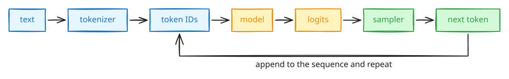
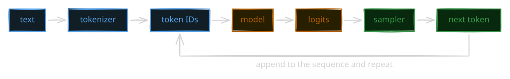

# 1.1 Run and serve an LLM

[](https://colab.research.google.com/github/modular/max-llm-book/blob/main/notebooks/01_01_run_and_serve.ipynb)
[](https://kaggle.com/kernels/welcome?src=https://github.com/modular/max-llm-book/blob/main/notebooks/01_01_run_and_serve.ipynb)
[](https://github.com/modular/max-llm-book/blob/main/notebooks/01_01_run_and_serve.ipynb)

In this section you run a real language model with MAX four ways, from three
lines of Python to an OpenAI-compatible server:

1. `AutoPipeline`: text in, text out.
2. `AutoTokenizer` and `AutoModel`: the tokens and scores underneath.
3. `max generate`: the same thing from the command line, with timings.
4. `max serve`: an HTTP server that any OpenAI client can call.

The model is
[SmolLM2-135M-Instruct](https://huggingface.co/HuggingFaceTB/SmolLM2-135M-Instruct),
a 135M-parameter chat model from Hugging Face. It is small enough to run
anywhere, and its architecture (the Llama family) is the one most open models
use. The rest of the book rebuilds it from scratch.

If you are new to LLM inference, read
[What is LLM inference?](https://handbook.modular.com/llm-inference-basics/what-is-llm-inference/)
in the Modular handbook first.

## Setup

MAX runs on a GPU if it finds one, otherwise on the CPU. Every call below
asks for `float32` numbers. MAX requires `float32` on a CPU, since it runs
`bfloat16` weights only on GPUs; on a GPU, `float32` keeps the results
comparable with the rest of the book. The first run downloads the
model (about 270 MB) and compiles it, which takes a minute; later runs reuse
both caches.

```python
import logging
import time

import numpy as np
import plotly.graph_objects as go
from max.pipelines import AutoPipeline
from openai import OpenAI
from transformers import AutoTokenizer as HFTokenizer

from minillm import viz

# MAX logs performance hints that don't matter at this model size.
logging.getLogger("max").setLevel(logging.ERROR)

MODEL = "HuggingFaceTB/SmolLM2-135M-Instruct"
FLOAT32 = dict(quantization_encoding="float32")
```

## Generate text in three lines

`AutoPipeline` loads a model and its tokenizer and generates text, much like
`transformers.pipeline`. `top_k=1` makes generation greedy: it always picks
the most likely next token, so the output is the same on every run.

```python
pipe = AutoPipeline(MODEL, **FLOAT32)
completion = pipe(["The capital of France is"], max_new_tokens=16, top_k=1)
assert "Paris" in completion[0]
completion
```

```text
['The capital of France is Paris. Paris is the largest city in France and the capital of the French department']
```

A plain string goes to the model as is, and the output starts with the
prompt. An instruct model is trained on conversations, so a list of chat
messages usually works better. The pipeline formats them with the model's
chat template and returns only the reply.

```python
messages = [{"role": "user", "content": "What is the capital of France?"}]
pipe([messages], max_new_tokens=32, top_k=1)
```

```text
['The capital of France is Paris.']
```

## Look underneath: tokens and scores

A language model doesn't read text. A tokenizer splits the text into
*tokens* (whole words, pieces of words, or punctuation) and maps each to an
integer ID. SmolLM2's vocabulary has 49,152 tokens.

```python
tokenizer = pipe.tokenizer
ids = tokenizer(["The capital of France is"])["input_ids"][0]
print(ids)
viz.tokens([tokenizer.decode([i]) for i in ids], ids)
```

<div style="line-height:2"><span title="token ID 504" style="background:rgba(42,120,214,0.22);border-radius:4px;padding:2px 4px;margin:0 2px 4px 0;display:inline-block;font-family:ui-monospace,monospace;font-size:0.9em">The</span><span title="token ID 3575" style="background:rgba(235,104,52,0.22);border-radius:4px;padding:2px 4px;margin:0 2px 4px 0;display:inline-block;font-family:ui-monospace,monospace;font-size:0.9em">&middot;capital</span><span title="token ID 282" style="background:rgba(27,175,122,0.22);border-radius:4px;padding:2px 4px;margin:0 2px 4px 0;display:inline-block;font-family:ui-monospace,monospace;font-size:0.9em">&middot;of</span><span title="token ID 4649" style="background:rgba(237,161,0,0.25);border-radius:4px;padding:2px 4px;margin:0 2px 4px 0;display:inline-block;font-family:ui-monospace,monospace;font-size:0.9em">&middot;France</span><span title="token ID 314" style="background:rgba(232,123,164,0.25);border-radius:4px;padding:2px 4px;margin:0 2px 4px 0;display:inline-block;font-family:ui-monospace,monospace;font-size:0.9em">&middot;is</span></div>

```text
[504, 3575, 282, 4649, 314]
```

Each chip is one token; hover over it for its ID, and the dots mark spaces.
Common words are single tokens, usually with their leading space. Rare
words, numbers, and code split into pieces:

```python
text = (
    "Tokenizers split unbelievably rare words, 3.14159, and snake_case_names."
)
pieces = tokenizer([text])["input_ids"][0]
viz.tokens([tokenizer.decode([i]) for i in pieces], pieces)
```

<div style="line-height:2"><span title="token ID 20855" style="background:rgba(42,120,214,0.22);border-radius:4px;padding:2px 4px;margin:0 2px 4px 0;display:inline-block;font-family:ui-monospace,monospace;font-size:0.9em">Token</span><span title="token ID 7927" style="background:rgba(235,104,52,0.22);border-radius:4px;padding:2px 4px;margin:0 2px 4px 0;display:inline-block;font-family:ui-monospace,monospace;font-size:0.9em">izers</span><span title="token ID 7074" style="background:rgba(27,175,122,0.22);border-radius:4px;padding:2px 4px;margin:0 2px 4px 0;display:inline-block;font-family:ui-monospace,monospace;font-size:0.9em">&middot;split</span><span title="token ID 33282" style="background:rgba(237,161,0,0.25);border-radius:4px;padding:2px 4px;margin:0 2px 4px 0;display:inline-block;font-family:ui-monospace,monospace;font-size:0.9em">&middot;unbelie</span><span title="token ID 102" style="background:rgba(232,123,164,0.25);border-radius:4px;padding:2px 4px;margin:0 2px 4px 0;display:inline-block;font-family:ui-monospace,monospace;font-size:0.9em">v</span><span title="token ID 1756" style="background:rgba(98,80,214,0.22);border-radius:4px;padding:2px 4px;margin:0 2px 4px 0;display:inline-block;font-family:ui-monospace,monospace;font-size:0.9em">ably</span><span title="token ID 3861" style="background:rgba(42,120,214,0.22);border-radius:4px;padding:2px 4px;margin:0 2px 4px 0;display:inline-block;font-family:ui-monospace,monospace;font-size:0.9em">&middot;rare</span><span title="token ID 1924" style="background:rgba(235,104,52,0.22);border-radius:4px;padding:2px 4px;margin:0 2px 4px 0;display:inline-block;font-family:ui-monospace,monospace;font-size:0.9em">&middot;words</span><span title="token ID 28" style="background:rgba(27,175,122,0.22);border-radius:4px;padding:2px 4px;margin:0 2px 4px 0;display:inline-block;font-family:ui-monospace,monospace;font-size:0.9em">,</span><span title="token ID 216" style="background:rgba(237,161,0,0.25);border-radius:4px;padding:2px 4px;margin:0 2px 4px 0;display:inline-block;font-family:ui-monospace,monospace;font-size:0.9em">&middot;</span><span title="token ID 35" style="background:rgba(232,123,164,0.25);border-radius:4px;padding:2px 4px;margin:0 2px 4px 0;display:inline-block;font-family:ui-monospace,monospace;font-size:0.9em">3</span><span title="token ID 30" style="background:rgba(98,80,214,0.22);border-radius:4px;padding:2px 4px;margin:0 2px 4px 0;display:inline-block;font-family:ui-monospace,monospace;font-size:0.9em">.</span><span title="token ID 33" style="background:rgba(42,120,214,0.22);border-radius:4px;padding:2px 4px;margin:0 2px 4px 0;display:inline-block;font-family:ui-monospace,monospace;font-size:0.9em">1</span><span title="token ID 36" style="background:rgba(235,104,52,0.22);border-radius:4px;padding:2px 4px;margin:0 2px 4px 0;display:inline-block;font-family:ui-monospace,monospace;font-size:0.9em">4</span><span title="token ID 33" style="background:rgba(27,175,122,0.22);border-radius:4px;padding:2px 4px;margin:0 2px 4px 0;display:inline-block;font-family:ui-monospace,monospace;font-size:0.9em">1</span><span title="token ID 37" style="background:rgba(237,161,0,0.25);border-radius:4px;padding:2px 4px;margin:0 2px 4px 0;display:inline-block;font-family:ui-monospace,monospace;font-size:0.9em">5</span><span title="token ID 41" style="background:rgba(232,123,164,0.25);border-radius:4px;padding:2px 4px;margin:0 2px 4px 0;display:inline-block;font-family:ui-monospace,monospace;font-size:0.9em">9</span><span title="token ID 28" style="background:rgba(98,80,214,0.22);border-radius:4px;padding:2px 4px;margin:0 2px 4px 0;display:inline-block;font-family:ui-monospace,monospace;font-size:0.9em">,</span><span title="token ID 284" style="background:rgba(42,120,214,0.22);border-radius:4px;padding:2px 4px;margin:0 2px 4px 0;display:inline-block;font-family:ui-monospace,monospace;font-size:0.9em">&middot;and</span><span title="token ID 14321" style="background:rgba(235,104,52,0.22);border-radius:4px;padding:2px 4px;margin:0 2px 4px 0;display:inline-block;font-family:ui-monospace,monospace;font-size:0.9em">&middot;snake</span><span title="token ID 79" style="background:rgba(27,175,122,0.22);border-radius:4px;padding:2px 4px;margin:0 2px 4px 0;display:inline-block;font-family:ui-monospace,monospace;font-size:0.9em">_</span><span title="token ID 7544" style="background:rgba(237,161,0,0.25);border-radius:4px;padding:2px 4px;margin:0 2px 4px 0;display:inline-block;font-family:ui-monospace,monospace;font-size:0.9em">case</span><span title="token ID 79" style="background:rgba(232,123,164,0.25);border-radius:4px;padding:2px 4px;margin:0 2px 4px 0;display:inline-block;font-family:ui-monospace,monospace;font-size:0.9em">_</span><span title="token ID 6464" style="background:rgba(98,80,214,0.22);border-radius:4px;padding:2px 4px;margin:0 2px 4px 0;display:inline-block;font-family:ui-monospace,monospace;font-size:0.9em">names</span><span title="token ID 30" style="background:rgba(42,120,214,0.22);border-radius:4px;padding:2px 4px;margin:0 2px 4px 0;display:inline-block;font-family:ui-monospace,monospace;font-size:0.9em">.</span></div>

A chat message is text and tokens too. The chat template wraps each message
in special tokens and adds a default system prompt. MAX loads the model's
Hugging Face tokenizer, so the `transformers` library can show what the
question from earlier becomes before the model sees it:

```python
template = HFTokenizer.from_pretrained(MODEL).apply_chat_template(
    messages, add_generation_prompt=True, tokenize=False
)
chat_ids = tokenizer([template])["input_ids"][0]
print(len(chat_ids), "tokens")
viz.tokens([tokenizer.decode([i]) for i in chat_ids], chat_ids)
```

<div style="line-height:2"><span title="token ID 1" style="background:rgba(42,120,214,0.22);border-radius:4px;padding:2px 4px;margin:0 2px 4px 0;display:inline-block;font-family:ui-monospace,monospace;font-size:0.9em">&lt;|im_start|&gt;</span><span title="token ID 9690" style="background:rgba(235,104,52,0.22);border-radius:4px;padding:2px 4px;margin:0 2px 4px 0;display:inline-block;font-family:ui-monospace,monospace;font-size:0.9em">system</span><span title="token ID 198" style="background:rgba(27,175,122,0.22);border-radius:4px;padding:2px 4px;margin:0 2px 4px 0;display:inline-block;font-family:ui-monospace,monospace;font-size:0.9em">&crarr;</span><span title="token ID 2683" style="background:rgba(237,161,0,0.25);border-radius:4px;padding:2px 4px;margin:0 2px 4px 0;display:inline-block;font-family:ui-monospace,monospace;font-size:0.9em">You</span><span title="token ID 359" style="background:rgba(232,123,164,0.25);border-radius:4px;padding:2px 4px;margin:0 2px 4px 0;display:inline-block;font-family:ui-monospace,monospace;font-size:0.9em">&middot;are</span><span title="token ID 253" style="background:rgba(98,80,214,0.22);border-radius:4px;padding:2px 4px;margin:0 2px 4px 0;display:inline-block;font-family:ui-monospace,monospace;font-size:0.9em">&middot;a</span><span title="token ID 5356" style="background:rgba(42,120,214,0.22);border-radius:4px;padding:2px 4px;margin:0 2px 4px 0;display:inline-block;font-family:ui-monospace,monospace;font-size:0.9em">&middot;helpful</span><span title="token ID 5646" style="background:rgba(235,104,52,0.22);border-radius:4px;padding:2px 4px;margin:0 2px 4px 0;display:inline-block;font-family:ui-monospace,monospace;font-size:0.9em">&middot;AI</span><span title="token ID 11173" style="background:rgba(27,175,122,0.22);border-radius:4px;padding:2px 4px;margin:0 2px 4px 0;display:inline-block;font-family:ui-monospace,monospace;font-size:0.9em">&middot;assistant</span><span title="token ID 3365" style="background:rgba(237,161,0,0.25);border-radius:4px;padding:2px 4px;margin:0 2px 4px 0;display:inline-block;font-family:ui-monospace,monospace;font-size:0.9em">&middot;named</span><span title="token ID 3511" style="background:rgba(232,123,164,0.25);border-radius:4px;padding:2px 4px;margin:0 2px 4px 0;display:inline-block;font-family:ui-monospace,monospace;font-size:0.9em">&middot;Sm</span><span title="token ID 308" style="background:rgba(98,80,214,0.22);border-radius:4px;padding:2px 4px;margin:0 2px 4px 0;display:inline-block;font-family:ui-monospace,monospace;font-size:0.9em">ol</span><span title="token ID 34519" style="background:rgba(42,120,214,0.22);border-radius:4px;padding:2px 4px;margin:0 2px 4px 0;display:inline-block;font-family:ui-monospace,monospace;font-size:0.9em">LM</span><span title="token ID 28" style="background:rgba(235,104,52,0.22);border-radius:4px;padding:2px 4px;margin:0 2px 4px 0;display:inline-block;font-family:ui-monospace,monospace;font-size:0.9em">,</span><span title="token ID 7018" style="background:rgba(27,175,122,0.22);border-radius:4px;padding:2px 4px;margin:0 2px 4px 0;display:inline-block;font-family:ui-monospace,monospace;font-size:0.9em">&middot;trained</span><span title="token ID 411" style="background:rgba(237,161,0,0.25);border-radius:4px;padding:2px 4px;margin:0 2px 4px 0;display:inline-block;font-family:ui-monospace,monospace;font-size:0.9em">&middot;by</span><span title="token ID 407" style="background:rgba(232,123,164,0.25);border-radius:4px;padding:2px 4px;margin:0 2px 4px 0;display:inline-block;font-family:ui-monospace,monospace;font-size:0.9em">&middot;H</span><span title="token ID 19712" style="background:rgba(98,80,214,0.22);border-radius:4px;padding:2px 4px;margin:0 2px 4px 0;display:inline-block;font-family:ui-monospace,monospace;font-size:0.9em">ugging</span><span title="token ID 8182" style="background:rgba(42,120,214,0.22);border-radius:4px;padding:2px 4px;margin:0 2px 4px 0;display:inline-block;font-family:ui-monospace,monospace;font-size:0.9em">&middot;Face</span><span title="token ID 2" style="background:rgba(235,104,52,0.22);border-radius:4px;padding:2px 4px;margin:0 2px 4px 0;display:inline-block;font-family:ui-monospace,monospace;font-size:0.9em">&lt;|im_end|&gt;</span><span title="token ID 198" style="background:rgba(27,175,122,0.22);border-radius:4px;padding:2px 4px;margin:0 2px 4px 0;display:inline-block;font-family:ui-monospace,monospace;font-size:0.9em">&crarr;</span><span title="token ID 1" style="background:rgba(237,161,0,0.25);border-radius:4px;padding:2px 4px;margin:0 2px 4px 0;display:inline-block;font-family:ui-monospace,monospace;font-size:0.9em">&lt;|im_start|&gt;</span><span title="token ID 4093" style="background:rgba(232,123,164,0.25);border-radius:4px;padding:2px 4px;margin:0 2px 4px 0;display:inline-block;font-family:ui-monospace,monospace;font-size:0.9em">user</span><span title="token ID 198" style="background:rgba(98,80,214,0.22);border-radius:4px;padding:2px 4px;margin:0 2px 4px 0;display:inline-block;font-family:ui-monospace,monospace;font-size:0.9em">&crarr;</span><span title="token ID 1780" style="background:rgba(42,120,214,0.22);border-radius:4px;padding:2px 4px;margin:0 2px 4px 0;display:inline-block;font-family:ui-monospace,monospace;font-size:0.9em">What</span><span title="token ID 314" style="background:rgba(235,104,52,0.22);border-radius:4px;padding:2px 4px;margin:0 2px 4px 0;display:inline-block;font-family:ui-monospace,monospace;font-size:0.9em">&middot;is</span><span title="token ID 260" style="background:rgba(27,175,122,0.22);border-radius:4px;padding:2px 4px;margin:0 2px 4px 0;display:inline-block;font-family:ui-monospace,monospace;font-size:0.9em">&middot;the</span><span title="token ID 3575" style="background:rgba(237,161,0,0.25);border-radius:4px;padding:2px 4px;margin:0 2px 4px 0;display:inline-block;font-family:ui-monospace,monospace;font-size:0.9em">&middot;capital</span><span title="token ID 282" style="background:rgba(232,123,164,0.25);border-radius:4px;padding:2px 4px;margin:0 2px 4px 0;display:inline-block;font-family:ui-monospace,monospace;font-size:0.9em">&middot;of</span><span title="token ID 4649" style="background:rgba(98,80,214,0.22);border-radius:4px;padding:2px 4px;margin:0 2px 4px 0;display:inline-block;font-family:ui-monospace,monospace;font-size:0.9em">&middot;France</span><span title="token ID 47" style="background:rgba(42,120,214,0.22);border-radius:4px;padding:2px 4px;margin:0 2px 4px 0;display:inline-block;font-family:ui-monospace,monospace;font-size:0.9em">?</span><span title="token ID 2" style="background:rgba(235,104,52,0.22);border-radius:4px;padding:2px 4px;margin:0 2px 4px 0;display:inline-block;font-family:ui-monospace,monospace;font-size:0.9em">&lt;|im_end|&gt;</span><span title="token ID 198" style="background:rgba(27,175,122,0.22);border-radius:4px;padding:2px 4px;margin:0 2px 4px 0;display:inline-block;font-family:ui-monospace,monospace;font-size:0.9em">&crarr;</span><span title="token ID 1" style="background:rgba(237,161,0,0.25);border-radius:4px;padding:2px 4px;margin:0 2px 4px 0;display:inline-block;font-family:ui-monospace,monospace;font-size:0.9em">&lt;|im_start|&gt;</span><span title="token ID 520" style="background:rgba(232,123,164,0.25);border-radius:4px;padding:2px 4px;margin:0 2px 4px 0;display:inline-block;font-family:ui-monospace,monospace;font-size:0.9em">ass</span><span title="token ID 9531" style="background:rgba(98,80,214,0.22);border-radius:4px;padding:2px 4px;margin:0 2px 4px 0;display:inline-block;font-family:ui-monospace,monospace;font-size:0.9em">istant</span><span title="token ID 198" style="background:rgba(42,120,214,0.22);border-radius:4px;padding:2px 4px;margin:0 2px 4px 0;display:inline-block;font-family:ui-monospace,monospace;font-size:0.9em">&crarr;</span></div>

```text
37 tokens
```

Given the IDs, the model produces one score (a *logit*) for every token in
the vocabulary: its prediction of what comes next. `AutoModel.generate` can
return those scores. Softmax turns them into probabilities: it
exponentiates each logit \\(z\_i\\) and divides by the total, so every
probability is positive and they sum to 1:

\\[p\_i = \\frac{e^{z\_i}}{\\sum\_j e^{z\_j}}\\]

```python
model = pipe.model
out = model.generate(input_ids=[ids], max_new_tokens=1, output_logits=True)

logits = out.logits[0][0]  # first prompt, first new token: [vocab_size]
probs = np.exp(logits - logits.max())
probs /= probs.sum()
assert tokenizer.decode([int(probs.argmax())]) == " Paris"
```

<details class="code-fold">
<summary>Show the code <span class="code-fold-lines">20 lines</span></summary>

```python
top = np.argsort(probs)[::-1][:10]
fig = go.Figure(
    go.Bar(
        x=probs[top],
        y=[repr(tokenizer.decode([int(i)])) for i in top],
        orientation="h",
        marker_color=viz.BLUE,
        text=[f"{p:.1%}" for p in probs[top]],
        textposition="outside",
        customdata=top,
        hovertemplate="%{y} (ID %{customdata}): %{x:.2%}<extra></extra>",
    )
)
fig.update_layout(
    title="The ten likeliest tokens after 'The capital of France is'",
    height=420,
    xaxis=dict(title="probability", tickformat=".0%", range=[0, 1.1]),
    yaxis=dict(autorange="reversed", showgrid=False),
)
viz.show(fig)
```

</details>

<div class="plotly-figure" data-src="generated/01_01_run_and_serve_16_0.json"></div>

Generation repeats this step: pick a token from the distribution, append it, and
run the model again. Picking the top token is greedy decoding; sampling from the
distribution gives more varied text.
[Section 1.7](01_07_sampling.md) implements both.

## Measure it

Two numbers describe how fast a model feels:

- Time to first token (TTFT) is how long the user waits before anything
  appears. It covers *prefill*, which processes the whole prompt at once.
- Time per output token (TPOT) is how long each later token takes. Each
  one is a *decode* step that processes a single new token.

Generating one token measures prefill; generating 65 adds 64 decode steps.
Each timing below is the median of three runs:

```python
def seconds(prompt: list[int], n_tokens: int) -> float:
    start = time.perf_counter()
    model.generate(
        input_ids=[prompt], max_new_tokens=n_tokens, top_k=1, ignore_eos=True
    )
    return time.perf_counter() - start


def ttft_tpot(prompt: list[int], repeats: int = 3) -> tuple[float, float]:
    """Returns the median TTFT and TPOT of ``prompt``, in seconds."""
    ttft = float(np.median([seconds(prompt, 1) for _ in range(repeats)]))
    total = float(np.median([seconds(prompt, 65) for _ in range(repeats)]))
    return ttft, (total - ttft) / 64


ttft, tpot = ttft_tpot(ids)
print(
    f"TTFT {ttft * 1000:.0f} ms, TPOT {tpot * 1000:.1f} ms ({1 / tpot:.0f} tokens/s)"
)
```

```text
TTFT 11 ms, TPOT 9.2 ms (108 tokens/s)
```

Prefill processes every prompt token, so TTFT should grow with the prompt.
A decode step processes one token, so TPOT should barely change. Check both
with prompts of random token IDs from 8 to 2,048 tokens long:

```python
rng = np.random.default_rng(0)
prompt_lengths = [8, 64, 256, 1024, 2048]
ttfts, tpots = [], []
for length in prompt_lengths:
    prompt = rng.integers(0, len(probs), length).tolist()
    seconds(prompt, 2)  # warm up this length
    ttft_s, tpot_s = ttft_tpot(prompt)
    ttfts.append(ttft_s * 1000)
    tpots.append(tpot_s * 1000)
    print(
        f"{length:5} prompt tokens: TTFT {ttfts[-1]:6.1f} ms, "
        f"TPOT {tpots[-1]:5.1f} ms"
    )
```

```text
    8 prompt tokens: TTFT   11.0 ms, TPOT   9.3 ms
   64 prompt tokens: TTFT   14.8 ms, TPOT   9.2 ms
  256 prompt tokens: TTFT   73.6 ms, TPOT   9.4 ms
 1024 prompt tokens: TTFT  670.0 ms, TPOT   9.4 ms
 2048 prompt tokens: TTFT 2470.4 ms, TPOT   9.1 ms
```

<details class="code-fold">
<summary>Show the code <span class="code-fold-lines">23 lines</span></summary>

```python
fig = go.Figure(
    [
        go.Scatter(
            x=prompt_lengths,
            y=ms,
            name=name,
            mode="lines+markers",
            line_color=color,
            hovertemplate=name + ", %{x} tokens: %{y:.1f} ms<extra></extra>",
        )
        for name, ms, color in [
            ("time to first token", ttfts, viz.ORANGE),
            ("time per output token", tpots, viz.BLUE),
        ]
    ]
)
fig.update_layout(
    title="Prefill grows with the prompt; a decode step barely does",
    height=420,
    xaxis=dict(title="prompt length (tokens, log scale)", type="log", dtick=1),
    yaxis=dict(title="ms (log scale)", type="log", dtick=1),
)
viz.show(fig)
```

</details>

<div class="plotly-figure" data-src="generated/01_01_run_and_serve_21_0.json"></div>

TTFT grows with the prompt, steeply past a few hundred tokens, while TPOT
stays nearly flat. A decode step still attends over the whole sequence, but
that work is small next to reading every weight once per step.

`ignore_eos=True` keeps generating past the end-of-sequence token, so every run
does the same amount of work.
[LLM inference metrics](https://handbook.modular.com/llm-inference-basics/llm-inference-metrics/)
in the handbook defines these and the other metrics engines report.

Close the pipeline to free its memory. `max generate` and `max serve`
below load the model again.

```python
pipe.close()
```

## The command line: `max generate`

The `max` command, installed with MAX, runs the same pipeline from a shell.
In a notebook, a line that starts with `!` runs as a shell command.
`max generate` applies the chat template to `--prompt` and prints timing
statistics after the text.

```python
!max generate --model HuggingFaceTB/SmolLM2-135M-Instruct --quantization-encoding float32 \
    --prompt "What is the capital of France?" --max-new-tokens 32 --top-k 1 2>/dev/null
```

```text
The capital of France is Paris.
Prompt size: 37
Output size: 8
Startup time: 0.32830238342285156 ms
Time to first token: 29.28781509399414 ms
Prompt eval throughput (context-encoding): 1263.3240097035216 tokens per second
Time per Output Token: 9.826013020106725 ms
Eval throughput (token-generation): 101.77067727813153 tokens per second
Total Latency: 98.06990623474121 ms
Total Throughput: 10.196807954586895 req/s
```

The lines to read are time to first token and time per output token: TTFT
and TPOT again. Expect different values from the ones above, since this is
one timed run of a different prompt. The prompt size is 37 tokens, not the 7
words typed, because the chat template adds the special tokens and system
prompt shown earlier. `2>/dev/null` hides the startup log. Run `max generate --help`
to see every option.

## Serve the model

`max serve` starts an HTTP server with an OpenAI-compatible API, so any
OpenAI client library or tool can use your model. In a terminal you would run:

```bash
max serve --model HuggingFaceTB/SmolLM2-135M-Instruct \
  --quantization-encoding float32
```

From a notebook, start it in the background and wait until its `/health`
endpoint answers:

<details class="code-fold">
<summary>Show <code>start_max_serve</code> <span class="code-fold-lines">29 lines</span></summary>

```python
from __future__ import annotations

import subprocess
import time
import urllib.request


def start_max_serve(
    model: str, *flags: str, port: int = 8000
) -> subprocess.Popen:
    """Starts ``max serve`` and returns once its health check answers.

    Call ``terminate()`` on the returned process to stop the server.
    """
    process = subprocess.Popen(
        ["max", "serve", "--model", model, "--port", str(port), *flags],
        stdout=subprocess.DEVNULL,
        stderr=subprocess.DEVNULL,
    )
    while True:
        try:
            urllib.request.urlopen(f"http://localhost:{port}/health")
            return process
        except OSError:
            if process.poll() is not None:
                raise RuntimeError(
                    "max serve exited; run it in a terminal to see why"
                ) from None
            time.sleep(1)
```

</details>

<small>Saved to `minillm/server.py`.</small>

```python
start = time.perf_counter()
server = start_max_serve(MODEL, "--quantization-encoding", "float32")
print(f"server ready in {time.perf_counter() - start:.0f} s")
```

```text
server ready in 17 s
```

Now call it with the official `openai` package. The API key is unused but
required by the client.

```python
client = OpenAI(base_url="http://localhost:8000/v1", api_key="unused")
reply = client.chat.completions.create(
    model=MODEL,
    messages=[{"role": "user", "content": "Name three primary colors."}],
    max_tokens=128,
    temperature=0,
)
print(reply.choices[0].message.content)
print(
    reply.usage.prompt_tokens,
    "prompt tokens,",
    reply.usage.completion_tokens,
    "completion tokens",
)
assert reply.choices[0].message.content.strip()
```

```text
The primary colors are:

1. Red: A warm, reddish-brown color that is often associated with fire, blood, and fire.
2. Blue: A cool, deep, and deep blue color that is often associated with water, sky, and sky.
3. Yellow: A bright, golden yellow color that is often associated with earth, light, and light.

These colors are often used to represent the primary elements of a painting or artwork, and they can be used to create a sense of depth and dimensionality.
35 prompt tokens, 112 completion tokens
```

Chat apps show the reply as it is generated. With `stream=True` the server
sends each token as soon as the model produces it:

```python
stream = client.chat.completions.create(
    model=MODEL,
    messages=[{"role": "user", "content": "Count from one to ten in words."}],
    max_tokens=48,
    temperature=0,
    stream=True,
)
for chunk in stream:
    print(chunk.choices[0].delta.content or "", end="", flush=True)
```

```text
1. One
2. Two
3. Three
4. Four
5. Five
6. Six
7. Seven
8. Eight
9. Nine
10. Ten
```

```python
server.terminate()
_ = server.wait()
```

[OpenAI-compatible API](https://handbook.modular.com/model-interaction/openai-compatible-api/)
in the handbook covers the request format, and
[Inference parameters](https://handbook.modular.com/model-interaction/inference-parameters/)
explains `temperature`, `top_p`, and the other sampling options.

## What MAX did

Each call above ran the same pipeline:



Inside, MAX also compiled the model into optimized kernels, kept a *KV
cache* so each decode step processes one token instead of the whole
sequence, and scheduled requests so the server can batch them. In the rest
of the book you build each of these parts yourself:

| Where | You build | With |
|---|---|---|
| [1.2](01_02_tensors_and_eager.md) | Tensors, eager execution, compilation | `max.tensor`, `max.functional` |
| [1.3](01_03_tokens_and_weights.md) | Tokens, embeddings, weight loading | `max.nn.Embedding`, safetensors |
| [1.4](01_04_building_blocks.md) | RMSNorm, rotary embeddings, the MLP | `max.nn` layers |
| [1.5](01_05_attention.md) | Causal grouped-query attention | `max.functional`, flash attention |
| [1.6](01_06_full_model.md) | The full model, checked against `AutoModel` | `max.nn.Module`, `compile` |
| [1.7](01_07_sampling.md) | Generation and sampling | your model |
| [1.8](01_08_kv_cache.md) | A KV cache | your model |
| [2](ch02.md) | The model split across several devices | `max.tensor.sharding` |
| [3](ch03.md) | Your own kernels in Mojo | `%%mojo`, `F.custom`, `max.graph` |
| [4](ch04.md) to [7](ch07.md) | Testing, a serving engine, bigger models, production serving | |

## Exercises

1. Ask the chat model a few questions of your own. Where does a 135M model
   go wrong?
2. Pass `temperature=0.8` instead of `top_k=1` and run the same prompt
   several times. What changes?
3. Load the model with `AutoModel(MODEL, max_batch_size=4, **FLOAT32)` and
   time four prompts at once (`input_ids=[ids] * 4`). How do TTFT and TPOT
   change compared with one prompt?

## Next

[Section 1.2](01_02_tensors_and_eager.md) introduces
the tensor library you build the model with: `max.tensor`, `max.functional`, and
eager execution.
