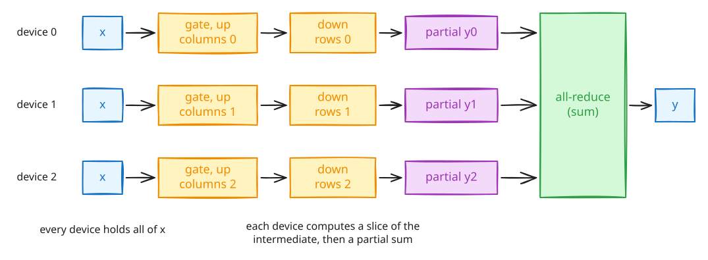
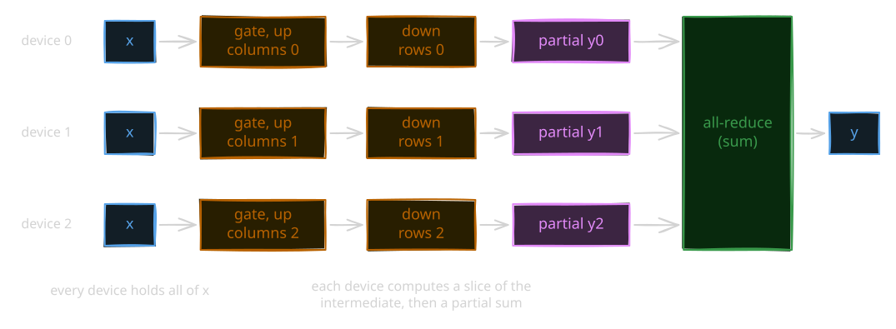

# 2.2 A tensor-parallel model

[](https://colab.research.google.com/github/modular/max-llm-book/blob/main/notebooks/02_02_tensor_parallel.ipynb)
[](https://kaggle.com/kernels/welcome?src=https://github.com/modular/max-llm-book/blob/main/notebooks/02_02_tensor_parallel.ipynb)
[](https://github.com/modular/max-llm-book/blob/main/notebooks/02_02_tensor_parallel.ipynb)

This section splits your SmolLM2 from
[Chapter 1](ch01.md) across three devices with tensor
parallelism, the strategy servers use to run a model too big or too slow for one
GPU. The model code doesn't change. You change where its weights live, and MAX
runs every layer on all three devices and adds the communication. Then you check
that the logits match the single-device model's.

<details class="code-fold">
<summary>Show the setup <span class="code-fold-lines">31 lines</span></summary>

```python
import logging
import time
import warnings

import numpy as np
import plotly.graph_objects as go
from max import functional as F
from max.driver import CPU
from max.dtype import DType
from max.nn.common_layers.linear import col_parallel, row_parallel
from max.pipelines import AutoTokenizer
from max.tensor import Tensor, default_device, default_dtype
from max.tensor.sharding import (
    DeviceMapping,
    DeviceMesh,
    Replicated,
    auto_reshard,
    visualize,
)
from max.tensor.tensor import TensorType

from minillm import viz
from minillm.config import MODEL_ID, LlamaConfig
from minillm.model import LlamaForCausalLM, load_model
from minillm.weights import load_checkpoint

logging.getLogger("max").setLevel(logging.ERROR)
warnings.filterwarnings("ignore", message="The eager interpreter failed")

config = LlamaConfig.from_pretrained()
weights = load_checkpoint()
```

</details>

## The plan

[Section 2.1](02_01_distributed_tensors.md) showed the
pattern: a column-parallel layer followed by a row-parallel layer needs one
all-reduce. Each SmolLM2 layer has two such pairs:

| Block | Column parallel (split outputs) | Row parallel (split inputs) |
|---|---|---|
| Attention | `q_proj`, `k_proj`, `v_proj` | `o_proj` |
| MLP | `gate_proj`, `up_proj` | `down_proj` |



Splitting `q_proj`'s outputs three ways gives each device 3 of the 9 query
heads, and splitting `k_proj` and `v_proj` gives each device 1 of the 3
key/value heads, the one those queries share under grouped-query attention
([Section 1.5](01_05_attention.md)). So attention runs
on each device independently, on its own heads. The embedding, the norms, and
the LM head stay whole on every device (replicated).

`max.nn` provides `col_parallel` and `row_parallel`, which change a `Linear`
layer's weight placement on the mesh axis you name:

```python
from __future__ import annotations

from max.nn.common_layers.linear import col_parallel, row_parallel

from minillm.model import LlamaForCausalLM


def tensor_parallel(
    model: LlamaForCausalLM, axis: str = "tp"
) -> LlamaForCausalLM:
    """Shards every layer's projections across mesh axis ``axis``."""
    for layer in model.model.layers:
        attn, mlp = layer.self_attn, layer.mlp
        for linear in (
            attn.q_proj,
            attn.k_proj,
            attn.v_proj,
            mlp.gate_proj,
            mlp.up_proj,
        ):
            col_parallel(linear, axis)
        for linear in (attn.o_proj, mlp.down_proj):
            row_parallel(linear, axis)
    return model
```

<small>Saved to `minillm/parallel.py`.</small>

## Build the model on a mesh

Build the model inside `default_device(mesh)` so its weights are created on
the mesh, apply the plan, and load the checkpoint. `load_state_dict` cuts
each weight into the shards its placement asks for:

```python
mesh = DeviceMesh((CPU(),) * 3, (3,), ("tp",))

with F.lazy(), default_device(mesh), default_dtype(DType.float32):
    tp_model = tensor_parallel(LlamaForCausalLM(config))
tp_model.load_state_dict(
    {**weights, "lm_head.weight": weights["model.embed_tokens.weight"]}
)

visualize(tp_model.model.layers[0].self_attn.q_proj.weight)
visualize(tp_model.model.layers[0].self_attn.o_proj.weight)
```

```text
DType.float32 [576, 576] with DeviceMapping(DeviceMesh(tp=3), [Sharded(axis=0)])
┌──────────────┐   tensor[:, :]
│   device 0   │   ├── tp=0  device 0 - tensor[:192, :]
│  [:192, :]   │   ├── tp=1  device 1 - tensor[192:384, :]
├──────────────┤   └── tp=2  device 2 - tensor[384:, :]
│   device 1   │
│ [192:384, :] │
├──────────────┤
│   device 2   │
│  [384:, :]   │
└──────────────┘
DType.float32 [576, 576] with DeviceMapping(DeviceMesh(tp=3), [Sharded(axis=1)])
┌──────────────┬──────────────┬──────────────┐   tensor[:, :]
│   device 0   │   device 1   │   device 2   │   ├── tp=0  device 0 - tensor[:, :192]
│  [:, :192]   │ [:, 192:384] │  [:, 384:]   │   ├── tp=1  device 1 - tensor[:, 192:384]
└──────────────┴──────────────┴──────────────┘   └── tp=2  device 2 - tensor[:, 384:]
```

Read the head assignment straight from the shards: each device's slice of
`q_proj` holds whole query heads, and its slice of `k_proj` holds the
key/value head those queries share. Hover over a box to see its device:

<details class="code-fold">
<summary>Show the code <span class="code-fold-lines">43 lines</span></summary>

```python
attn = tp_model.model.layers[0].self_attn
rows = {
    "query heads": attn.q_proj.weight,
    "key/value heads": attn.k_proj.weight,
}
device_colors = [viz.BLUE, viz.ORANGE, viz.AQUA]
fig = go.Figure()
for y, (name, weight) in enumerate(rows.items()):
    head = 0
    for device, shard in enumerate(weight.local_shards):
        for _ in range(int(shard.shape[0]) // config.head_dim):
            width = (
                9 / int(weight.shape[0]) * config.head_dim
            )  # key/value heads span their group
            fig.add_trace(
                go.Bar(
                    x=[width],
                    base=[head * width],
                    y=[name],
                    orientation="h",
                    width=0.6,
                    marker=dict(
                        color=device_colors[device],
                        line=dict(color=viz.SURFACE, width=3),
                    ),
                    text=f"{'q' if y == 0 else 'kv'}{head}",
                    textposition="inside",
                    insidetextanchor="middle",
                    name=f"device {device}",
                    legendgroup=str(device),
                    showlegend=y == 0 and head % 3 == 0,
                    hovertemplate=f"{name[:-1]} {head} on device {device}<extra></extra>",
                )
            )
            head += 1
fig.update_layout(
    title="Layer 0's attention heads on a 3-device mesh",
    height=260,
    barmode="overlay",
    xaxis=dict(visible=False),
    yaxis=dict(autorange="reversed", showgrid=False),
)
viz.show(fig)
```

</details>

<div class="plotly-figure" data-src="generated/02_02_tensor_parallel_8_0.json"></div>

`Linear` stores its weight as `[out, in]`, so column parallel splits axis 0
and row parallel splits axis 1. Each device now holds a third of every
projection, which is most of the model:

```python
def elements_on_device_0(model) -> int:
    total = 0
    for _, p in model.parameters:
        shard = p.local_shards[0] if p.is_distributed else p
        total += int(np.prod([int(d) for d in shard.shape]))
    return total


total = sum(p.num_elements() for _, p in tp_model.parameters)
print(
    f"whole model: {total / 1e6:.0f}M values, device 0 holds {elements_on_device_0(tp_model) / 1e6:.0f}M"
)
```

```text
whole model: 163M values, device 0 holds 92M
```

The whole-model count is above SmolLM2's 135M because the model ties its LM
head to the embedding, and the count includes that 28M-value weight twice.
Broken down by part, for the single-device model and for each device of the
mesh:

<details class="code-fold">
<summary>Show <code>part</code> <span class="code-fold-lines">43 lines</span></summary>

```python
def part(name: str) -> str:
    for key, label in [
        ("embed_tokens", "embedding"),
        ("lm_head", "LM head"),
        ("self_attn", "attention"),
        ("mlp", "MLP"),
    ]:
        if key in name:
            return label
    return "norms"


parts = ["embedding", "LM head", "attention", "MLP", "norms"]
columns = ["one device", "mesh device 0", "mesh device 1", "mesh device 2"]
counts = {p: [0] * 4 for p in parts}
for name, param in tp_model.parameters:
    counts[part(name)][0] += param.num_elements()
    shards = param.local_shards if param.is_distributed else [param] * 3
    for device, shard in enumerate(shards):
        counts[part(name)][device + 1] += int(
            np.prod([int(d) for d in shard.shape])
        )

fig = go.Figure(
    [
        go.Bar(
            x=columns,
            y=np.array(values) / 1e6,
            name=p,
            marker_color=color,
            hovertemplate=p + ": %{y:.1f}M values<extra>%{x}</extra>",
        )
        for (p, values), color in zip(counts.items(), viz.SERIES)
    ]
)
fig.update_layout(
    title="Parameter values per device",
    barmode="stack",
    height=420,
    yaxis_title="millions of values",
    legend_traceorder="normal",
)
viz.show(fig)
```

</details>

<div class="plotly-figure" data-src="generated/02_02_tensor_parallel_12_0.json"></div>

The replicated embedding and LM head (28M values each) keep device 0 well
above a third. Large models also split those across the vocabulary.

## Run it

The input token IDs are replicated: every device sees the whole prompt. Run
the model with `auto_reshard(mode="warn")` to see each collective MAX
inserts:

```python
tokenizer = AutoTokenizer(MODEL_ID)
ids = tokenizer(["The capital of France is"])["input_ids"][0]
tokens = Tensor(np.array([ids]), device=DeviceMapping(mesh, (Replicated(),)))

start = time.perf_counter()
with warnings.catch_warnings(record=True) as caught:
    warnings.simplefilter("always")
    with auto_reshard(mode="warn"):
        tp_logits = tp_model(tokens).to_numpy()
reshards = [str(w.message) for w in caught if "reshards" in str(w.message)]
print(
    f"forward pass in {time.perf_counter() - start:.0f} s, {len(reshards)} collectives inserted"
)
assert len(reshards) == 2 * config.num_hidden_layers
print(reshards[0])
```

```text
forward pass in 215 s, 60 collectives inserted

add(lhs, rhs) reshards rhs
  lhs    : float32[1, 5, 576]@mesh(tp=3){"tp":R}
  rhs    : float32[1, 5, 576]@mesh(tp=3){"tp":P}
  region : auto_reshard(DEFAULT_TRANSITIONS, mode="warn")

  decided per mesh axis
  axis    lhs          rhs          -> out       collective                             bytes   status
  "tp"    lhs{R->P}    rhs{P}       -> P         keep_one_copy(lhs)                         60  not allowed
          lhs{R->S1}   rhs{P->S1}   -> S1        local_slice(lhs), reduce_scatter(rhs)    7740  not allowed
          lhs{R->S2}   rhs{P->S2}   -> S2        local_slice(lhs), reduce_scatter(rhs)    7740  not allowed
          lhs{R}       rhs{P->R}    -> R         allreduce(rhs)                          15360  chosen, reshards rhs
  result  lhs{"tp":R}  rhs{"tp":R}  -> {"tp":R}

  rhs = transfer_to(rhs, DeviceMapping(mesh, (R,)))
  with auto_reshard(mode="silent"):
  with auto_reshard(ALL_TRANSITIONS, mode="silent"):   # also allows the cheaper rows above
  at minillm/model.py:43 in forward()
```

That makes 60 collectives for 30 layers, two all-reduces per layer: one where
the output of attention's row-parallel `o_proj` meets the residual addition,
and one where the MLP's `down_proj` output does. Each residual addition needs
the full value, so a column-then-row layout needs both. Everything else,
including attention itself, ran on each device without communication. The
forward pass is slow because the simulated mesh runs eagerly, one operation at
a time, on one CPU; its time says nothing about real hardware.

## Check it

The sharded model must produce the same logits as the single-device model
from [Section 1.6](01_06_full_model.md):

```python
single = load_model(config, weights, CPU()).compile(
    TensorType(DType.int64, ("batch", "seq_len"), device=CPU())
)
reference = single(Tensor(np.array([ids]), device=CPU())).to_numpy()

print(f"max difference {np.abs(tp_logits - reference).max():.1e}")
print("next token:", repr(tokenizer.decode([int(tp_logits[0, -1].argmax())])))
assert (
    np.abs(tp_logits - reference).max() < 1e-3
    and tp_logits[0, -1].argmax() == reference[0, -1].argmax()
)
```

```text
max difference 7.0e-05
next token: ' Paris'
```

The logits agree to within `1e-4`, the size of a change in summation order:
the all-reduce adds three partial sums where one device computed one full
sum. On real hardware, replace the mesh's `CPU()` entries with
`Accelerator(0)`, `Accelerator(1)`, and `Accelerator(2)`, and nothing else
changes. `max serve` splits models across GPUs too: pass
`--devices gpu:0,1,2` to use three. MAX's Llama implementation, which serves
SmolLM2, uses the same column-then-row layout, built from the older
tensor-parallel layers in `max.nn.legacy` instead of distributed tensors, and
it also splits the embedding and the LM head across the vocabulary.

Simulation answers *is it correct?* cheaply. Whether a layout is *fast* depends
on the hardware: an all-reduce over NVLink costs microseconds, over PCIe or a
network much more, and for a model this small on real GPUs the communication
would cost more than it saves. The handbook's
[distributed inference](https://handbook.modular.com/infrastructure-and-operations/distributed-inference/)
and
[parallelism strategies](https://handbook.modular.com/inference-optimization/data-tensor-pipeline-expert-hybrid-parallelism/)
pages discuss when each layout pays off.

## Exercises

1. Run on a 9-device mesh, one query head per device. What happens to the
   key/value heads, which only split three ways?
2. Shard the embedding by vocabulary (rows) and the LM head to match. Which
   collectives does MAX add, and how much memory does device 0 save?
3. Add a `dp` axis for a 2 × 3 mesh and run a batch of two prompts with the
   batch split along `dp`. Check both rows against the single-device model.

## Next

[Chapter 3](ch03.md) goes below the operations: you
write a kernel in Mojo and call it from your model.
