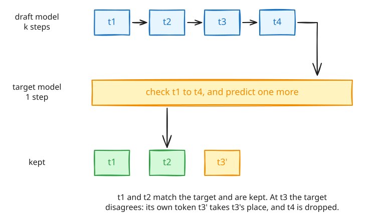
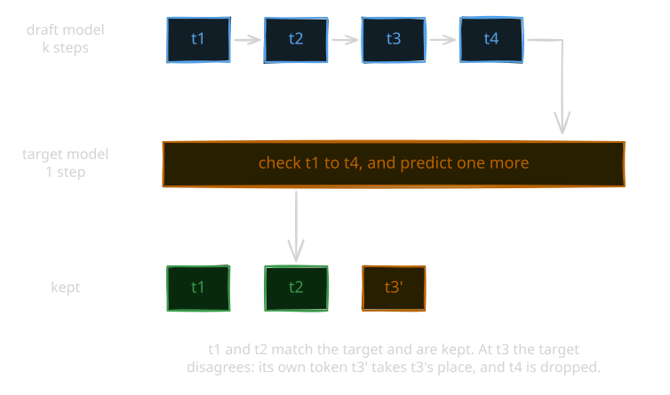

# 5.5 Speculative decoding

[](https://colab.research.google.com/github/modular/max-llm-book/blob/main/notebooks/05_05_speculative_decoding.ipynb)
[](https://kaggle.com/kernels/welcome?src=https://github.com/modular/max-llm-book/blob/main/notebooks/05_05_speculative_decoding.ipynb)
[](https://github.com/modular/max-llm-book/blob/main/notebooks/05_05_speculative_decoding.ipynb)

Decoding produces one token per step of the model, and at small batch sizes each
step is memory-bound:
[Section 4.3](04_03_kernel_benchmarks.md#memory-bound-or-compute-bound)
showed that a step for several tokens costs little more than a step for one.
*Speculative decoding* uses that spare capacity. A small, fast *draft* model
guesses the next few tokens, and the large *target* model checks all the guesses
in one step. Each guess the target agrees with is an extra token from that one
target step, and with greedy decoding the output is exactly what the target
alone would produce.

This section implements it with SmolLM2-135M drafting for SmolLM2-360M, a
larger model from the same family, and measures when it pays off.

<details class="code-fold">
<summary>Show the setup <span class="code-fold-lines">19 lines</span></summary>

```python
import logging
import time
import warnings

import numpy as np
import plotly.graph_objects as go
from max.pipelines import AutoTokenizer

from minillm import viz
from minillm.device import pick_device
from minillm.config import MODEL_ID, LlamaConfig
from minillm.model import load_model
from minillm.step import ContiguousCache, StepModel, compile_step, run_step
from minillm.weights import load_checkpoint

logging.getLogger("max").setLevel(logging.ERROR)
warnings.filterwarnings("ignore", message="The eager interpreter failed")
DEVICE = pick_device()  # a GPU if MAX finds one, otherwise the CPU
TARGET_ID = "HuggingFaceTB/SmolLM2-360M-Instruct"
```

</details>

## Two changes to the step model

Verification needs the target's prediction after *every* guessed token, not
only the last, so the target's step returns logits for all positions. When
the target rejects a guess, the keys and values computed for the rejected
tokens must be dropped, so the cache gets a `truncate` method.

<details class="code-fold">
<summary>Show <code>AllLogitsStepModel</code>, <code>TruncatableCache</code>, <code>build</code> <span class="code-fold-lines">30 lines</span></summary>

```python
class AllLogitsStepModel(StepModel):
    def forward(self, tokens, positions, mask, past):
        x = self.model.embed_tokens(tokens)
        new_kv = []
        for layer, layer_past in zip(self.model.layers, past, strict=True):
            x, kv = layer(x, positions, mask, layer_past)
            new_kv.append(kv)
        return self.lm_head(self.model.norm(x)), new_kv


class TruncatableCache(ContiguousCache):
    def truncate(self, length: int) -> None:
        for entry in self.layers:
            entry[0], entry[1] = entry[0][:length], entry[1][:length]


def build(model_id: str):
    config = LlamaConfig.from_pretrained(model_id)
    model = load_model(
        config, load_checkpoint(model_id), DEVICE, AllLogitsStepModel
    )
    return config, compile_step(model, config, DEVICE)


draft_config, draft = build(MODEL_ID)
target_config, target = build(TARGET_ID)
print(
    f"draft: {draft_config.num_hidden_layers} layers x {draft_config.hidden_size}, "
    f"target: {target_config.num_hidden_layers} layers x {target_config.hidden_size}"
)
```

</details>

```text
draft: 30 layers x 576, target: 32 layers x 960
```

Both models share a tokenizer, which this kind of speculative decoding
requires: the target must read the draft's token IDs as the same tokens.

## The baseline: the target alone

```python
tokenizer = AutoTokenizer(MODEL_ID)
prompt = tokenizer(["The three primary colors are"])["input_ids"][0]
N = 48


def target_alone() -> tuple[list[int], float]:
    cache, ids = TruncatableCache(target_config), list(prompt)
    start = time.perf_counter()
    logits = run_step(target, [cache], [ids], DEVICE)
    while True:
        ids.append(int(logits[0, -1].argmax()))
        if len(ids) - len(prompt) == N:
            break
        logits = run_step(target, [cache], [[ids[-1]]], DEVICE)
    return ids[len(prompt) :], time.perf_counter() - start


reference, reference_time = target_alone()
print(f"{N / reference_time:.1f} tokens/s")
print(tokenizer.decode(reference))
```

```text
2.5 tokens/s
 red, blue, and yellow. These colors can be combined in various ways to create other colors. For example, by mixing red and blue, you get purple. Similarly, by mixing red and yellow, you get orange. By mixing blue
```

## Draft, then verify



Each round:

1. The draft model generates `k` tokens greedily, one step each. Its first
   step also feeds in any accepted tokens it hasn't seen yet.
2. The target runs *one* step over the last accepted token plus the `k`
   guesses, and returns its own greedy choice after each of them.
3. Guesses are accepted from the left for as long as they match the
   target's choice. At the first mismatch, the target's choice replaces the
   guess. If all `k` match, the target's choice after the last one comes
   free. So every round yields between 1 and `k + 1` tokens.
4. Both caches are truncated to the accepted tokens, which discards the keys
   and values of rejected guesses.

Because every emitted token is the target's own greedy choice, the output is
identical to the target alone. Sampling versions accept or reject each guess
with a probability test that keeps the output distributed exactly as the
target's own samples would be.

<details class="code-fold">
<summary>Show <code>speculative</code> <span class="code-fold-lines">42 lines</span></summary>

```python
def speculative(
    k: int, log: list | None = None
) -> tuple[list[int], float, int, int]:
    target_cache, draft_cache = (
        TruncatableCache(target_config),
        TruncatableCache(draft_config),
    )
    ids = list(prompt)
    rounds = accepted = 0
    start = time.perf_counter()
    logits = run_step(target, [target_cache], [ids], DEVICE)
    ids.append(int(logits[0, -1].argmax()))
    if log is not None:  # for the figure below: where each token came from
        log.append(("prefill", ids[-1]))
    while len(ids) - len(prompt) < N:
        guesses = []
        logits = run_step(
            draft, [draft_cache], [ids[draft_cache.length :]], DEVICE
        )
        for i in range(k):
            guesses.append(int(logits[0, -1].argmax()))
            if i < k - 1:
                logits = run_step(draft, [draft_cache], [[guesses[-1]]], DEVICE)
        checks = run_step(
            target,
            [target_cache],
            [ids[target_cache.length :] + guesses],
            DEVICE,
        )[0]
        choices = checks[-(k + 1) :].argmax(-1)
        n = 0
        while n < k and guesses[n] == int(choices[n]):
            n += 1
        ids += guesses[:n] + [int(choices[n])]
        if log is not None:
            log += [("accepted", t) for t in guesses[:n]]
            log.append(("bonus" if n == k else "corrected", int(choices[n])))
        rounds += 1
        accepted += n
        target_cache.truncate(len(ids) - 1)
        draft_cache.truncate(min(draft_cache.length, len(ids) - 1))
    return ids[len(prompt) :][:N], time.perf_counter() - start, rounds, accepted
```

</details>

```python
print(
    f"{'k':>2} {'same output':>11} {'target steps':>12} {'accepted':>9} {'tokens/s':>9}"
)
print(f"{'-':>2} {'-':>11} {N:>12} {'-':>9} {N / reference_time:>9.1f}")
results = {}
for k in [2, 4, 6]:
    out, seconds, rounds, accepted = speculative(k)
    results[k] = (rounds, accepted)
    print(
        f"{k:>2} {str(out == reference):>11} {rounds:>12} {accepted / (rounds * k):>9.0%} {N / seconds:>9.1f}"
    )
    assert out == reference and rounds < N
```

```text
 k same output target steps  accepted  tokens/s
 -           -           48         -       2.5
 2        True           21       64%       2.2
 4        True           15       58%       1.4
 6        True           15       41%       1.2
```

Look inside the run with `k = 4`. Each chip is one output token. The first,
in yellow, comes from the target's prefill. Blue chips are draft guesses the
target accepted, orange ones are the target's corrections where a guess was
wrong, and green ones are the extra token a round earns when all four
guesses are right. Hover over a chip for its round:

<details class="code-fold">
<summary>Show the code <span class="code-fold-lines">23 lines</span></summary>

```python
log = []
speculative(4, log)
log = log[:N]
kinds = {
    "prefill": viz.CHIP_COLORS[3],
    "accepted": viz.CHIP_COLORS[0],
    "corrected": viz.CHIP_COLORS[1],
    "bonus": viz.CHIP_COLORS[2],
}
titles, current = [], 0
for kind, _ in log:
    titles.append(
        "the target's prefill"
        if kind == "prefill"
        else f"round {current}: {kind}"
    )
    current += kind != "accepted"
viz.tokens(
    [tokenizer.decode([t]) for _, t in log],
    [t for _, t in log],
    colors=[kinds[kind] for kind, _ in log],
    titles=titles,
)
```

</details>

<div style="line-height:2"><span title="the target&#x27;s prefill" style="background:rgba(237,161,0,0.25);border-radius:4px;padding:2px 4px;margin:0 2px 4px 0;display:inline-block;font-family:ui-monospace,monospace;font-size:0.9em">&middot;red</span><span title="round 1: accepted" style="background:rgba(42,120,214,0.22);border-radius:4px;padding:2px 4px;margin:0 2px 4px 0;display:inline-block;font-family:ui-monospace,monospace;font-size:0.9em">,</span><span title="round 1: accepted" style="background:rgba(42,120,214,0.22);border-radius:4px;padding:2px 4px;margin:0 2px 4px 0;display:inline-block;font-family:ui-monospace,monospace;font-size:0.9em">&middot;blue</span><span title="round 1: accepted" style="background:rgba(42,120,214,0.22);border-radius:4px;padding:2px 4px;margin:0 2px 4px 0;display:inline-block;font-family:ui-monospace,monospace;font-size:0.9em">,</span><span title="round 1: accepted" style="background:rgba(42,120,214,0.22);border-radius:4px;padding:2px 4px;margin:0 2px 4px 0;display:inline-block;font-family:ui-monospace,monospace;font-size:0.9em">&middot;and</span><span title="round 1: bonus" style="background:rgba(27,175,122,0.22);border-radius:4px;padding:2px 4px;margin:0 2px 4px 0;display:inline-block;font-family:ui-monospace,monospace;font-size:0.9em">&middot;yellow</span><span title="round 2: accepted" style="background:rgba(42,120,214,0.22);border-radius:4px;padding:2px 4px;margin:0 2px 4px 0;display:inline-block;font-family:ui-monospace,monospace;font-size:0.9em">.</span><span title="round 2: corrected" style="background:rgba(235,104,52,0.22);border-radius:4px;padding:2px 4px;margin:0 2px 4px 0;display:inline-block;font-family:ui-monospace,monospace;font-size:0.9em">&middot;These</span><span title="round 3: accepted" style="background:rgba(42,120,214,0.22);border-radius:4px;padding:2px 4px;margin:0 2px 4px 0;display:inline-block;font-family:ui-monospace,monospace;font-size:0.9em">&middot;colors</span><span title="round 3: corrected" style="background:rgba(235,104,52,0.22);border-radius:4px;padding:2px 4px;margin:0 2px 4px 0;display:inline-block;font-family:ui-monospace,monospace;font-size:0.9em">&middot;can</span><span title="round 4: accepted" style="background:rgba(42,120,214,0.22);border-radius:4px;padding:2px 4px;margin:0 2px 4px 0;display:inline-block;font-family:ui-monospace,monospace;font-size:0.9em">&middot;be</span><span title="round 4: corrected" style="background:rgba(235,104,52,0.22);border-radius:4px;padding:2px 4px;margin:0 2px 4px 0;display:inline-block;font-family:ui-monospace,monospace;font-size:0.9em">&middot;combined</span><span title="round 5: corrected" style="background:rgba(235,104,52,0.22);border-radius:4px;padding:2px 4px;margin:0 2px 4px 0;display:inline-block;font-family:ui-monospace,monospace;font-size:0.9em">&middot;in</span><span title="round 6: accepted" style="background:rgba(42,120,214,0.22);border-radius:4px;padding:2px 4px;margin:0 2px 4px 0;display:inline-block;font-family:ui-monospace,monospace;font-size:0.9em">&middot;various</span><span title="round 6: accepted" style="background:rgba(42,120,214,0.22);border-radius:4px;padding:2px 4px;margin:0 2px 4px 0;display:inline-block;font-family:ui-monospace,monospace;font-size:0.9em">&middot;ways</span><span title="round 6: accepted" style="background:rgba(42,120,214,0.22);border-radius:4px;padding:2px 4px;margin:0 2px 4px 0;display:inline-block;font-family:ui-monospace,monospace;font-size:0.9em">&middot;to</span><span title="round 6: accepted" style="background:rgba(42,120,214,0.22);border-radius:4px;padding:2px 4px;margin:0 2px 4px 0;display:inline-block;font-family:ui-monospace,monospace;font-size:0.9em">&middot;create</span><span title="round 6: bonus" style="background:rgba(27,175,122,0.22);border-radius:4px;padding:2px 4px;margin:0 2px 4px 0;display:inline-block;font-family:ui-monospace,monospace;font-size:0.9em">&middot;other</span><span title="round 7: accepted" style="background:rgba(42,120,214,0.22);border-radius:4px;padding:2px 4px;margin:0 2px 4px 0;display:inline-block;font-family:ui-monospace,monospace;font-size:0.9em">&middot;colors</span><span title="round 7: corrected" style="background:rgba(235,104,52,0.22);border-radius:4px;padding:2px 4px;margin:0 2px 4px 0;display:inline-block;font-family:ui-monospace,monospace;font-size:0.9em">.</span><span title="round 8: accepted" style="background:rgba(42,120,214,0.22);border-radius:4px;padding:2px 4px;margin:0 2px 4px 0;display:inline-block;font-family:ui-monospace,monospace;font-size:0.9em">&middot;For</span><span title="round 8: accepted" style="background:rgba(42,120,214,0.22);border-radius:4px;padding:2px 4px;margin:0 2px 4px 0;display:inline-block;font-family:ui-monospace,monospace;font-size:0.9em">&middot;example</span><span title="round 8: accepted" style="background:rgba(42,120,214,0.22);border-radius:4px;padding:2px 4px;margin:0 2px 4px 0;display:inline-block;font-family:ui-monospace,monospace;font-size:0.9em">,</span><span title="round 8: corrected" style="background:rgba(235,104,52,0.22);border-radius:4px;padding:2px 4px;margin:0 2px 4px 0;display:inline-block;font-family:ui-monospace,monospace;font-size:0.9em">&middot;by</span><span title="round 9: corrected" style="background:rgba(235,104,52,0.22);border-radius:4px;padding:2px 4px;margin:0 2px 4px 0;display:inline-block;font-family:ui-monospace,monospace;font-size:0.9em">&middot;mixing</span><span title="round 10: accepted" style="background:rgba(42,120,214,0.22);border-radius:4px;padding:2px 4px;margin:0 2px 4px 0;display:inline-block;font-family:ui-monospace,monospace;font-size:0.9em">&middot;red</span><span title="round 10: accepted" style="background:rgba(42,120,214,0.22);border-radius:4px;padding:2px 4px;margin:0 2px 4px 0;display:inline-block;font-family:ui-monospace,monospace;font-size:0.9em">&middot;and</span><span title="round 10: accepted" style="background:rgba(42,120,214,0.22);border-radius:4px;padding:2px 4px;margin:0 2px 4px 0;display:inline-block;font-family:ui-monospace,monospace;font-size:0.9em">&middot;blue</span><span title="round 10: accepted" style="background:rgba(42,120,214,0.22);border-radius:4px;padding:2px 4px;margin:0 2px 4px 0;display:inline-block;font-family:ui-monospace,monospace;font-size:0.9em">,</span><span title="round 10: bonus" style="background:rgba(27,175,122,0.22);border-radius:4px;padding:2px 4px;margin:0 2px 4px 0;display:inline-block;font-family:ui-monospace,monospace;font-size:0.9em">&middot;you</span><span title="round 11: accepted" style="background:rgba(42,120,214,0.22);border-radius:4px;padding:2px 4px;margin:0 2px 4px 0;display:inline-block;font-family:ui-monospace,monospace;font-size:0.9em">&middot;get</span><span title="round 11: accepted" style="background:rgba(42,120,214,0.22);border-radius:4px;padding:2px 4px;margin:0 2px 4px 0;display:inline-block;font-family:ui-monospace,monospace;font-size:0.9em">&middot;purple</span><span title="round 11: corrected" style="background:rgba(235,104,52,0.22);border-radius:4px;padding:2px 4px;margin:0 2px 4px 0;display:inline-block;font-family:ui-monospace,monospace;font-size:0.9em">.</span><span title="round 12: accepted" style="background:rgba(42,120,214,0.22);border-radius:4px;padding:2px 4px;margin:0 2px 4px 0;display:inline-block;font-family:ui-monospace,monospace;font-size:0.9em">&middot;Similarly</span><span title="round 12: accepted" style="background:rgba(42,120,214,0.22);border-radius:4px;padding:2px 4px;margin:0 2px 4px 0;display:inline-block;font-family:ui-monospace,monospace;font-size:0.9em">,</span><span title="round 12: accepted" style="background:rgba(42,120,214,0.22);border-radius:4px;padding:2px 4px;margin:0 2px 4px 0;display:inline-block;font-family:ui-monospace,monospace;font-size:0.9em">&middot;by</span><span title="round 12: accepted" style="background:rgba(42,120,214,0.22);border-radius:4px;padding:2px 4px;margin:0 2px 4px 0;display:inline-block;font-family:ui-monospace,monospace;font-size:0.9em">&middot;mixing</span><span title="round 12: bonus" style="background:rgba(27,175,122,0.22);border-radius:4px;padding:2px 4px;margin:0 2px 4px 0;display:inline-block;font-family:ui-monospace,monospace;font-size:0.9em">&middot;red</span><span title="round 13: accepted" style="background:rgba(42,120,214,0.22);border-radius:4px;padding:2px 4px;margin:0 2px 4px 0;display:inline-block;font-family:ui-monospace,monospace;font-size:0.9em">&middot;and</span><span title="round 13: accepted" style="background:rgba(42,120,214,0.22);border-radius:4px;padding:2px 4px;margin:0 2px 4px 0;display:inline-block;font-family:ui-monospace,monospace;font-size:0.9em">&middot;yellow</span><span title="round 13: accepted" style="background:rgba(42,120,214,0.22);border-radius:4px;padding:2px 4px;margin:0 2px 4px 0;display:inline-block;font-family:ui-monospace,monospace;font-size:0.9em">,</span><span title="round 13: accepted" style="background:rgba(42,120,214,0.22);border-radius:4px;padding:2px 4px;margin:0 2px 4px 0;display:inline-block;font-family:ui-monospace,monospace;font-size:0.9em">&middot;you</span><span title="round 13: bonus" style="background:rgba(27,175,122,0.22);border-radius:4px;padding:2px 4px;margin:0 2px 4px 0;display:inline-block;font-family:ui-monospace,monospace;font-size:0.9em">&middot;get</span><span title="round 14: accepted" style="background:rgba(42,120,214,0.22);border-radius:4px;padding:2px 4px;margin:0 2px 4px 0;display:inline-block;font-family:ui-monospace,monospace;font-size:0.9em">&middot;orange</span><span title="round 14: accepted" style="background:rgba(42,120,214,0.22);border-radius:4px;padding:2px 4px;margin:0 2px 4px 0;display:inline-block;font-family:ui-monospace,monospace;font-size:0.9em">.</span><span title="round 14: corrected" style="background:rgba(235,104,52,0.22);border-radius:4px;padding:2px 4px;margin:0 2px 4px 0;display:inline-block;font-family:ui-monospace,monospace;font-size:0.9em">&middot;By</span><span title="round 15: accepted" style="background:rgba(42,120,214,0.22);border-radius:4px;padding:2px 4px;margin:0 2px 4px 0;display:inline-block;font-family:ui-monospace,monospace;font-size:0.9em">&middot;mixing</span><span title="round 15: accepted" style="background:rgba(42,120,214,0.22);border-radius:4px;padding:2px 4px;margin:0 2px 4px 0;display:inline-block;font-family:ui-monospace,monospace;font-size:0.9em">&middot;blue</span></div>

The output matches the target alone, and the target runs far fewer steps: 15 to
21 verification rounds instead of 47 decode steps. Even so, on this page's
machine (an Apple-silicon Mac with a Metal GPU) every `k` was slower than the
target alone, at about 1 to 2 tokens/s against about 2.5. Treat these numbers
as an example: yours depend on your hardware and vary from run to run.

A timeline shows where the time goes. Run the target alone and the speculative
loop with `k = 4` once more, and time every call to `run_step`. Each bar is one
step, blue for the target and orange for the draft; hover over a target step in
the second row to see how many tokens its round produced:

<details class="code-fold">
<summary>Show <code>run_step</code> <span class="code-fold-lines">19 lines</span></summary>

```python
events, untimed = [], run_step


def run_step(step_fn, caches, new_tokens, device):
    start = time.perf_counter()
    logits = untimed(step_fn, caches, new_tokens, device)
    model = "draft" if step_fn is draft else "target"
    events.append((model, start, time.perf_counter(), len(new_tokens[0])))
    return logits


try:
    target_alone()
    baseline_events, events = events, []
    round_log = []
    speculative(4, round_log)
    spec_events = events
finally:
    run_step = untimed
```

</details>

<details class="code-fold">
<summary>Show the code <span class="code-fold-lines">68 lines</span></summary>

```python
# Tokens each round produced: its accepted guesses plus the target's own token.
per_round, accepted = [], 0
for kind, _ in round_log[1:]:
    if kind == "accepted":
        accepted += 1
    else:
        per_round.append(accepted + 1)
        accepted = 0
rows = {"target alone": baseline_events, "speculative, k = 4": spec_events}
traces = {
    "target": ([], [], [], [], viz.BLUE),
    "draft": ([], [], [], [], viz.ORANGE),
}
ends = []
for row, row_events in rows.items():
    t0 = row_events[0][1]
    verify = 0
    for index, (model, start, end, n) in enumerate(row_events):
        y, base, width, hover, _ = traces[model]
        y.append(row)
        base.append(start - t0)
        width.append(end - start)
        if index == 0:
            what = f"target prefill, {n} tokens"
        elif model == "draft":
            what = "draft step, 1 token"
        elif row == "target alone":
            what = "target decode step, 1 token"
        else:
            what = f"target verifies {n} tokens; round {verify + 1} yields {per_round[verify]}"
            verify += 1
        hover.append(f"{what}: {(end - start) * 1000:.0f} ms")
    ends.append((row, row_events[-1][2] - t0))
fig = go.Figure(
    [
        go.Bar(
            y=y,
            x=width,
            base=base,
            orientation="h",
            name=f"{model} step",
            marker=dict(color=color, line=dict(color=viz.SURFACE, width=1)),
            hovertext=hover,
            hoverinfo="text",
        )
        for model, (y, base, width, hover, color) in traces.items()
    ]
    + [
        go.Scatter(
            x=[end for _, end in ends],
            y=[row for row, _ in ends],
            mode="text",
            text=[f"  {N} tokens in {end:.1f} s" for _, end in ends],
            textposition="middle right",
            showlegend=False,
            hoverinfo="skip",
        )
    ]
)
fig.update_layout(
    title=f"Every step of generating {N} tokens, in wall-clock time",
    barmode="overlay",
    height=300,
    xaxis=dict(title="seconds", rangemode="tozero"),
    yaxis=dict(autorange="reversed", showgrid=False),
    margin=dict(r=140),
)
viz.show(fig)
```

</details>

<div class="plotly-figure" data-src="generated/05_05_speculative_decoding_14_0.json"></div>

In the second row, an orange draft step is about as wide as a blue target step,
and a target step that verifies five tokens costs about the same as one that
decodes a single token, as the cost model below assumes. A round spends four
draft steps to earn between one and five tokens, so the steps the target saves
are paid back, and more, by the draft.

## When it pays off

A round costs `k` draft steps plus one target step. If a draft step costs a
fraction \\(c\\) of a target step, and a round yields \\(\\bar{n}\\) tokens on
average, the speedup over the target alone is

\\[\\text{speedup} \\approx \\frac{\\bar{n}}{1 + k\\,c}\\]

This assumes the target verifies `k + 1` tokens in about the time of a
one-token step. Measure \\(c\\) for these two models:

```python
def ms_per_decode_step(step, config) -> float:
    cache = TruncatableCache(config)
    run_step(step, [cache], [prompt], DEVICE)
    start = time.perf_counter()
    for _ in range(10):
        run_step(step, [cache], [[42]], DEVICE)
    return (time.perf_counter() - start) / 10 * 1000


c = ms_per_decode_step(draft, draft_config) / ms_per_decode_step(
    target, target_config
)
print(f"c = {c:.2f}")
for k, (rounds, accepted) in results.items():
    tokens_per_round = (accepted + rounds) / rounds
    print(
        f"k={k}: {tokens_per_round:.2f} tokens per round -> predicted speedup {tokens_per_round / (1 + k * c):.2f}x"
    )
```

```text
c = 0.69
k=2: 2.29 tokens per round -> predicted speedup 0.96x
k=4: 3.33 tokens per round -> predicted speedup 0.89x
k=6: 3.47 tokens per round -> predicted speedup 0.68x
```

Plot the predicted speedup against the draft's relative cost \\(c\\), using the
acceptance measured for each `k`. Above the dashed line, speculation is
faster than the target alone; the dotted line marks the \\(c\\) of these two
models:

<details class="code-fold">
<summary>Show the code <span class="code-fold-lines">32 lines</span></summary>

```python
cs = np.logspace(-2, 0, 60)
fig = go.Figure()
for (k, (rounds, accepted)), color in zip(results.items(), viz.SERIES):
    per_round = (accepted + rounds) / rounds
    fig.add_trace(
        go.Scatter(
            x=cs,
            y=per_round / (1 + k * cs),
            name=f"k = {k}",
            line_color=color,
            hovertemplate=f"k = {k}, c = %{{x:.2f}}: %{{y:.2f}}x<extra></extra>",
        )
    )
fig.add_hline(y=1, line=dict(color=viz.INK_SECONDARY, dash="dash"))
fig.add_vline(
    x=c,
    line=dict(color=viz.INK_SECONDARY, dash="dot"),
    annotation_text=f"these models, c = {c:.2f}",
    annotation_position="top left",
)
fig.update_layout(
    title="Predicted speedup of speculative decoding",
    height=420,
    xaxis=dict(
        title="draft step cost / target step cost, c (log scale)",
        type="log",
        dtick=1,
        range=[-2.05, 0.05],
    ),
    yaxis=dict(title="speedup over the target alone", rangemode="tozero"),
)
viz.show(fig)
```

</details>

<div class="plotly-figure" data-src="generated/05_05_speculative_decoding_18_0.json"></div>

Here a draft step costs most of a target step, far more than the draft's 2.7
times fewer parameters suggest. The two models have almost the same depth,
30 and 32 layers, and at this size much of each layer's time is fixed per-step
work that doesn't shrink with the layer's width. Part of that fixed work is this
engine's own: `run_step` packs and copies every layer's keys and values on the
host at each step, so the measured \\(c\\) includes that host-side packing too. So
the `k` draft steps in a round cost more than the target steps they save, and
the cost model predicts speculation at or below the speed of the target alone.
The measured runs were slower still, but the conclusion is the same. A draft's depth matters as much as its parameter count.

Speculative decoding pays off when the draft is cheap (small \\(c\\)), its
guesses are usually accepted (large \\(\\bar{n}\\)), and verifying `k + 1`
tokens costs about one target step. A cheap draft can be a 1B model drafting
for a 70B target, or a small head trained on the target's own hidden states,
as in Medusa, EAGLE, and multi-token prediction (MTP). Cheap verification
holds for memory-bound decoding on GPUs and less so on a busy CPU.

With \\(c \\approx 0.05\\) and the acceptance measured above, the same code would run
about two to three times as fast as the target alone, as the chart shows. MAX
Serve's speculative decoding uses drafts that read the target model's hidden
states, such as EAGLE and MTP, selected with `--speculative-method`. The
handbook's
[speculative decoding](https://handbook.modular.com/inference-optimization/speculative-decoding/)
page compares the variants.

## Exercises

1. Plug different \\(c\\) values into the formula with the measured acceptance
   rates. For which \\(c\\) does each `k` break even?
2. Change the prompt to something more predictable, such as counting from 1
   to 50. How do acceptance and the best `k` change?
3. Make `k` adaptive: increase it after a fully accepted round and decrease
   it after an early rejection. Does it help?

## What you built

[Chapter 5](ch05.md) is complete. Your engine
schedules requests with continuous batching, stores keys and values in a paged
cache, and shares cached prefixes between requests, and a separate loop
speculates with a draft model for a single sequence. MAX Serve is built from the
same parts, with the kernels and scheduling that make them fast on GPUs.
[Chapter 6](ch06.md) returns to the model and extends
it to newer architectures.
