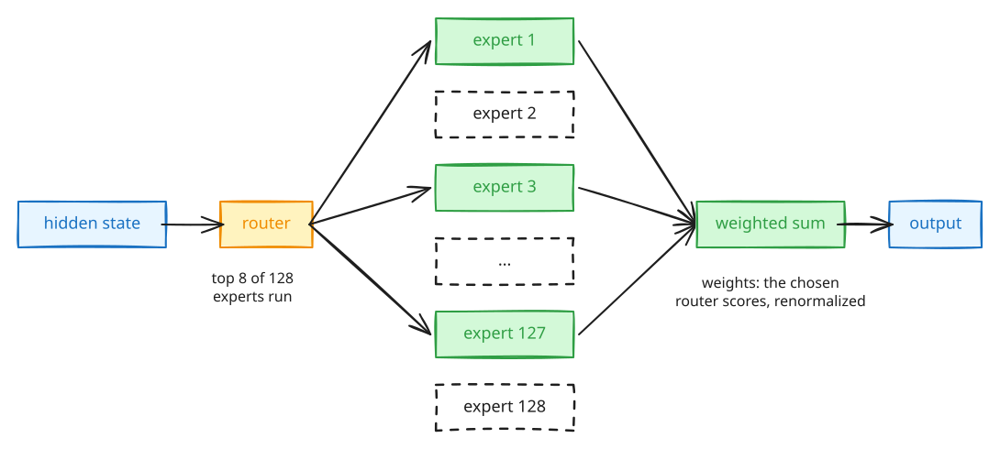
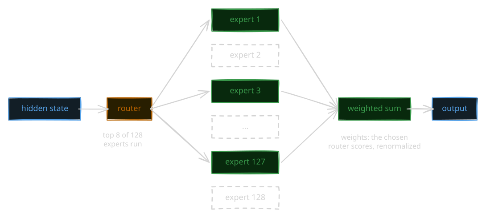

# 6.3 Mixture of experts

[](https://colab.research.google.com/github/modular/max-llm-book/blob/main/notebooks/06_03_mixture_of_experts.ipynb)
[](https://kaggle.com/kernels/welcome?src=https://github.com/modular/max-llm-book/blob/main/notebooks/06_03_mixture_of_experts.ipynb)
[](https://github.com/modular/max-llm-book/blob/main/notebooks/06_03_mixture_of_experts.ipynb)

The largest open models are *mixtures of experts* (MoE). An MoE layer has
many MLPs, the *experts*, instead of one, and a small *router* sends each
token to only a few of them. The model holds the parameters of all its
experts, while each token pays for only a fraction of them. This section
builds an MoE layer, checks it against Hugging Face's Qwen3-MoE
implementation, and then spreads the experts across devices.

No real MoE checkpoint fits on a laptop, so this section uses Qwen3-MoE's
architecture at a small size with random weights, a common way to test
large-model code. As in
[Section 4.1](04_01_layer_tests.md), the test compares
one layer with a reference implementation.

<details class="code-fold">
<summary>Show the setup <span class="code-fold-lines">32 lines</span></summary>

```python
import json
import logging
import warnings
from pathlib import Path

import numpy as np
import plotly.graph_objects as go
import torch
from huggingface_hub import hf_hub_download
from max import functional as F
from max.driver import CPU
from max.dtype import DType
from max.tensor import Tensor, default_device, default_dtype
from max.tensor.sharding import (
    DeviceMapping,
    DeviceMesh,
    Replicated,
    Sharded,
    auto_reshard,
)
from plotly.subplots import make_subplots
from transformers import AutoConfig
from transformers.models.qwen3_moe.modeling_qwen3_moe import (
    Qwen3MoeSparseMoeBlock,
)

from minillm import viz
from minillm.device import pick_device

logging.getLogger("max").setLevel(logging.ERROR)
warnings.filterwarnings("ignore", message="The eager interpreter failed")
DEVICE = pick_device()  # a GPU if MAX finds one, otherwise the CPU
```

</details>

## How big, and how sparse

Qwen3-30B-A3B is a typical MoE model. Its name gives its total parameters,
30 billion, and its active ones, about 3 billion:

```python
real = json.loads(
    Path(hf_hub_download("Qwen/Qwen3-30B-A3B", "config.json")).read_text()
)
E, K, H, I = (
    real["num_experts"],
    real["num_experts_per_tok"],
    real["hidden_size"],
    real["moe_intermediate_size"],
)
per_expert = 3 * H * I
print(f"{E} experts per layer, {K} chosen per token")
print(
    f"expert weights per layer: {E * per_expert / 1e6:.0f}M, used per token: {K * per_expert / 1e6:.0f}M"
)
```

```text
128 experts per layer, 8 chosen per token
expert weights per layer: 604M, used per token: 38M
```

Every token uses 8 of the 128 experts, so it touches only a sixteenth of each
layer's expert weights. Adding experts adds parameters without adding work per
token. The cost moves to memory, since every expert must be loaded somewhere,
which is why MoE models are usually served across several GPUs. The handbook's
[parallelism strategies](https://handbook.modular.com/inference-optimization/data-tensor-pipeline-expert-hybrid-parallelism/)
page covers expert parallelism, which the end of this section implements.

## The layer

An MoE layer replaces the MLP. For each token:

1. The router, a `Linear` from the hidden size to the number of experts, scores
   every expert. Softmax turns the scores into probabilities.
2. The `K` most probable experts are chosen, and their probabilities are
   renormalized to sum to 1. Qwen3-MoE's config asks for this with
   `norm_topk_prob: true`; a model that sets it to `false` weights the experts
   by their raw probabilities, so reusing `MoE` for one means dropping that
   step.
3. Each chosen expert, a SwiGLU MLP like the one in
   [Section 1.4](01_04_building_blocks.md), processes
   the token, and the outputs are summed, weighted by those probabilities.



In symbols, with router weights \\(W\_r\\), the set \\(\\mathcal{T}\\) of the \\(K\\)
most probable experts, and expert \\(e\\)'s MLP \\(E\_e\\):

\\[p = \\mathrm{softmax}(W\_r x), \\qquad
y = \\sum\_{e \\in \\mathcal{T}} \\frac{p\_e}{\\sum\_{j \\in \\mathcal{T}} p\_j} \\, E\_e(x)\\]

The experts' weights are stored stacked, with the expert as the first axis:
one tensor for the fused gate and up projections, and one for the down
projection. That is the layout of Hugging Face's Qwen3-MoE module; the
checkpoint files store each expert's projections separately. This version
computes *every* expert on every token and multiplies the unselected ones by
zero. That wastes work, but it is simple and exact, and the last part of
this section shows that it is easy to distribute.

<details class="code-fold">
<summary>Show <code>Experts</code>, <code>MoE</code> <span class="code-fold-lines">66 lines</span></summary>

```python
from __future__ import annotations

from max import functional as F
from max.dtype import DType
from max.nn import Linear, Module
from max.tensor import Tensor


class Experts(Module):
    """The stacked weights of every expert: gate and up projections fused."""

    def __init__(
        self, num_experts: int, hidden: int, intermediate: int
    ) -> None:
        self.gate_up_proj = Tensor.zeros(
            [num_experts, 2 * intermediate, hidden]
        )
        self.down_proj = Tensor.zeros([num_experts, hidden, intermediate])


class MoE(Module):
    """A mixture-of-experts layer with top-k routing, as in Qwen3-MoE."""

    def __init__(
        self, num_experts: int, top_k: int, hidden: int, intermediate: int
    ) -> None:
        self.num_experts, self.top_k, self.intermediate = (
            num_experts,
            top_k,
            intermediate,
        )
        self.gate = Linear(hidden, num_experts, bias=False)  # the router
        self.experts = Experts(num_experts, hidden, intermediate)

    def routing(self, x: Tensor) -> Tensor:
        """Returns each token's weight for each expert, ``[tokens, experts]``,
        zero for experts the token wasn't routed to."""
        tokens = x.shape[0]
        weights, chosen = F.top_k(F.softmax(self.gate(x)), self.top_k)
        weights = weights / weights.sum(axis=-1)
        ids = Tensor.arange(self.num_experts, dtype=DType.int64, device=x.mesh)
        one_hot = (
            chosen.reshape([tokens, self.top_k, 1])
            == ids.reshape([1, 1, self.num_experts])
        ).cast(x.dtype)
        return (
            (one_hot * weights.reshape([tokens, self.top_k, 1]))
            .sum(axis=1)
            .reshape([tokens, self.num_experts])
        )

    def forward(self, x: Tensor) -> Tensor:
        """``x`` is ``[tokens, hidden]``."""
        tokens, hidden = x.shape
        gate_up = x.reshape(
            [1, tokens, hidden]
        ) @ self.experts.gate_up_proj.transpose(1, 2)
        gate, up = (
            gate_up[:, :, : self.intermediate],
            gate_up[:, :, self.intermediate :],
        )
        outputs = (F.silu(gate) * up) @ self.experts.down_proj.transpose(
            1, 2
        )  # [E, T, H]
        weights = self.routing(x).T.reshape([self.num_experts, tokens, 1])
        return (weights * outputs).sum(axis=0).reshape([tokens, hidden])
```

</details>

<small>Saved to `minillm/moe.py`.</small>

## Check it against Qwen3-MoE

Build Hugging Face's Qwen3-MoE block at a small size, 8 experts with 2 per
token, fill it with random weights, and load the same weights into yours.
The parameter names match, so `load_state_dict` takes the PyTorch state
directly:

```python
torch.manual_seed(0)
small = AutoConfig.from_pretrained("Qwen/Qwen3-30B-A3B")
(
    small.hidden_size,
    small.moe_intermediate_size,
    small.num_experts,
    small.num_experts_per_tok,
) = 64, 32, 8, 2
reference = Qwen3MoeSparseMoeBlock(small).float().eval()
for p in reference.parameters():
    torch.nn.init.normal_(p, std=0.2)
state = {name: p.detach().numpy() for name, p in reference.state_dict().items()}
print({name: w.shape for name, w in state.items()})

with default_device(DEVICE), default_dtype(DType.float32):
    moe = MoE(num_experts=8, top_k=2, hidden=64, intermediate=32)
moe.load_state_dict(state)

x = np.random.default_rng(0).standard_normal((10, 64)).astype(np.float32)
with torch.no_grad():
    expected = reference(torch.from_numpy(x)[None])[0].numpy()
ours = moe(Tensor(x, device=DEVICE)).to_numpy()
print(f"max difference {np.abs(ours - expected).max():.1e}")
assert np.abs(ours - expected).max() < 1e-4
```

```text
{'experts.gate_up_proj': (8, 64, 64), 'experts.down_proj': (8, 64, 32), 'gate.weight': (8, 64)}
max difference 3.8e-06
```

## Where the tokens go

The routing matrix shows which experts each token uses. Count the tokens per
expert for a larger batch, then make the router favor expert 0 by scaling its
row of router weights, and count again:

```python
batch = Tensor(
    np.random.default_rng(1).standard_normal((512, 64)).astype(np.float32),
    device=DEVICE,
)
weights_np = moe.routing(batch).to_numpy()
load = (weights_np > 0).sum(axis=0)
print("tokens per expert:", load, " ideal:", 512 * 2 // 8)
assert load.sum() == 512 * 2


def load_with_bias(factor: float) -> np.ndarray:
    router = state["gate.weight"].copy()
    router[0] *= factor
    with default_device(DEVICE), default_dtype(DType.float32):
        biased = MoE(num_experts=8, top_k=2, hidden=64, intermediate=32)
    biased.load_state_dict({**state, "gate.weight": router})
    return (biased.routing(batch).to_numpy() > 0).sum(axis=0)


loads = {factor: load_with_bias(factor) for factor in [1, 2, 5]}
for factor, counts in loads.items():
    print(f"expert 0's row x{factor}: tokens per expert {counts}")
assert (loads[1] == load).all()
```

```text
tokens per expert: [122 116 157 121 117 134 122 135]  ideal: 128
expert 0's row x1: tokens per expert [122 116 157 121 117 134 122 135]
expert 0's row x2: tokens per expert [178 109 144 116 108 130 113 126]
expert 0's row x5: tokens per expert [227 104 136 109 103 121 104 120]
```

<details class="code-fold">
<summary>Show the code <span class="code-fold-lines">60 lines</span></summary>

```python
fig = make_subplots(
    rows=1,
    cols=2,
    column_widths=[0.6, 0.4],
    horizontal_spacing=0.2,
    subplot_titles=[
        "Routing weights of the first 32 tokens",
        "Tokens per expert, all 512",
    ],
)
fig.add_trace(
    go.Heatmap(
        z=np.where(weights_np[:32] > 0, weights_np[:32], np.nan),
        colorscale=viz.SEQUENTIAL,
        zmin=0,
        zmax=1,
        xgap=2,
        ygap=2,
        colorbar=dict(title="weight", thickness=12, x=0.5),
        hovertemplate="token %{y} -> expert %{x}: weight %{z:.2f}<extra></extra>",
    ),
    row=1,
    col=1,
)
steps = [
    [
        go.Bar(
            x=np.arange(len(counts)),
            y=counts,
            marker_color=[viz.ORANGE] + [viz.BLUE] * (len(counts) - 1),
            showlegend=False,
            xaxis="x2",
            yaxis="y2",
            hovertemplate="expert %{x}: %{y} tokens<extra></extra>",
        )
    ]
    for counts in loads.values()
]
fig.update_xaxes(title_text="expert", dtick=1, showgrid=False)
fig.update_yaxes(
    title_text="token", autorange="reversed", showgrid=False, row=1, col=1
)
fig.update_yaxes(
    title_text="tokens routed",
    range=[0, 1.1 * max(c.max() for c in loads.values())],
    row=1,
    col=2,
)
fig.update_layout(title="Top-2 routing over 8 experts", height=520)
labels = [f"x{factor}" for factor in loads]
viz.with_slider(fig, steps, labels, "expert 0's router row ")
fig.add_hline(
    y=512 * 2 / len(load),
    line=dict(color=viz.INK_SECONDARY, dash="dash"),
    row=1,
    col=2,
    annotation_text="even split",
    annotation_position="top right",
)
viz.show(fig)
```

</details>

<div class="plotly-figure" data-src="generated/06_03_mixture_of_experts_11_0.json"></div>

Every token went to exactly two experts. Move the slider to scale expert 0's
row of router weights: its scores grow, so more tokens pick it, and its bar
rises to nearly twice the even split at x5 while the others shrink. How evenly a batch
spreads across experts matters in practice: an expert that gets far more tokens
than the others becomes the slowest part of the layer. MoE models are usually trained
with a *load-balancing* term in the loss that pushes the router to spread
tokens evenly, and serving systems monitor the load on each expert.

This dense version computes all 8 experts for every token, 4 times the work
that the 2 chosen experts need. Production kernels instead group the tokens
by expert and run one matrix multiplication per expert over only its tokens
(a *grouped GEMM*), which removes the waste:

```python
per_expert_small = 3 * 64 * 32  # gate, up, and down projections
dense = 2 * 512 * 8 * per_expert_small
sparse = 2 * 512 * 2 * per_expert_small
print(
    f"dense: {dense / 1e6:.1f} MFLOP, routed: {sparse / 1e6:.1f} MFLOP, {dense / sparse:.0f}x less"
)
```

```text
dense: 50.3 MFLOP, routed: 12.6 MFLOP, 4x less
```

## Expert parallelism

The experts are independent, so they can live on different devices. With 8
experts on 4 devices, each device holds 2. Every device receives every token,
runs its own experts, and weights their outputs; the final sum over experts
spans devices, which takes one all-reduce. On the simulated mesh from
[Section 2.1](02_01_distributed_tensors.md), the only
change is to shard the stacked expert weights along the expert axis:

```python
mesh = DeviceMesh((CPU(),) * 4, (4,), ("ep",))
with default_device(mesh), default_dtype(DType.float32):
    ep_moe = MoE(num_experts=8, top_k=2, hidden=64, intermediate=32)
by_expert = DeviceMapping(mesh, (Sharded(0),))
ep_moe.experts.gate_up_proj = ep_moe.experts.gate_up_proj.to(by_expert)
ep_moe.experts.down_proj = ep_moe.experts.down_proj.to(by_expert)
ep_moe.load_state_dict(state)
print(ep_moe.experts.down_proj.mapping)

with warnings.catch_warnings(record=True) as caught:
    warnings.simplefilter("always")
    with auto_reshard(mode="warn"):
        ep_out = ep_moe(Tensor(x, device=DeviceMapping(mesh, (Replicated(),))))
for w in caught:
    if "reshards" in str(w.message):
        print(w.message)
print(
    f"max difference from the reference: {np.abs(ep_out.to_numpy() - expected).max():.1e}"
)
assert np.abs(ep_out.to_numpy() - expected).max() < 1e-4
```

```text
DeviceMapping(DeviceMesh(ep=4), [Sharded(axis=0)])

mul(lhs, rhs) reshards lhs
  lhs    : float32[8, 10, 1]@mesh(ep=4){"ep":R}
  rhs    : float32[8, 10, 64]@mesh(ep=4){"ep":S0}
  region : auto_reshard(DEFAULT_TRANSITIONS, mode="warn")

  decided per mesh axis
  axis    lhs           rhs           -> out        collective                          bytes    status
  "ep"    lhs{R->S0}    rhs{S0}       -> S0         local_slice(lhs)                      1.25   chosen, reshards lhs
          lhs{R}        rhs{S0->R}    -> R          allgather(rhs)                       15360
          lhs{R}        rhs{S0->S2}   -> S2         all_to_all(rhs)                      15360
          lhs{R->S1}    rhs{S0->S1}   -> S1         local_slice(lhs), all_to_all(rhs)   15361.2
          lhs{R->P}     rhs{S0->R}    -> P          keep_one_copy(lhs), allgather(rhs)  15361.2  not allowed
  result  lhs{"ep":S0}  rhs{"ep":S0}  -> {"ep":S0}

  lhs = transfer_to(lhs, DeviceMapping(mesh, (Sharded(0),)))
  with auto_reshard(mode="silent"):
  at <cell>:67 in forward()
max difference from the reference: 2.9e-06
```

The output matches. MAX resharded the routing weights to match the
experts' layout, so each device multiplies only its own experts' slice, and
the weighted outputs come out as partial sums that `to_numpy()` all-reduces.

This dense form sends every token to every device. Expert-parallel serving
sends each token only to the devices that hold its chosen experts, an
*all-to-all* exchange, and returns the results with a second one. With many
experts this moves far less data, but the communication is uneven and
depends on the routing. MAX serves MoE models such as GPT-OSS and DeepSeek,
and supports expert parallelism across GPUs with all-to-all dispatch and
combine steps.

## Exercises

1. Increase `top_k` to 8 (every expert). Does the output equal a weighted sum
   of 8 dense MLPs? What would the model lose?
2. Implement the routed version for one device: for each expert, gather its
   tokens, run the MLP on them only, and scatter the results back. Check it
   against `MoE`.
3. With the experts spread over 4 devices as above, 2 per device, how many
   token copies does each device process at each slider setting of the
   routing figure? What does the busiest device do to the time of an
   expert-parallel step?

## What you built

[Chapter 6](ch06.md) extended your model with three
features of current open models: normalized queries and keys, sliding-window
attention, and mixtures of experts.
[Chapter 7](ch07.md) serves your own architecture with
`max serve`, benchmarks it, and constrains its output.
